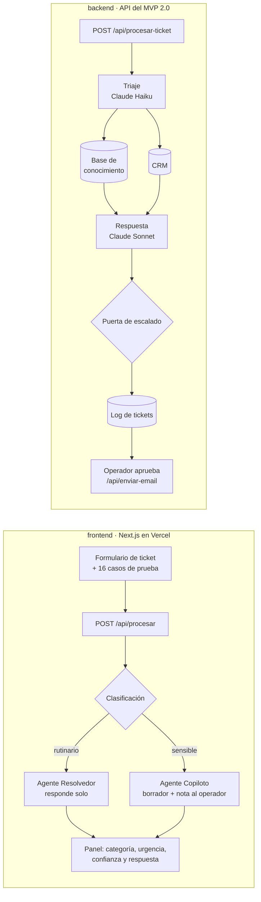

# Meraki, copiloto multiagente de atención al cliente

Copiloto de soporte para un SaaS B2B que recibe unos **3.000 tickets por mes**. Clasifica cada ticket, decide si lo resuelve solo o si lo asiste a un operador, y nunca resuelve sin una persona lo que es sensible.

> Proyecto grupal de Aplicaciones de IA a los Negocios, Licenciatura en Negocios Digitales, Universidad ORT Uruguay, 2026. Cliente ficticio: MercadoSur Tech.

**[Ver el video de la demo completa](https://drive.google.com/file/d/1wMIsEQ7Me_zeRFJm96U0wbQIbRS0SMe6/view)** · **[Probar el MVP](https://v0-meraki-mvp-project.vercel.app)**

## Arquitectura



Dos agentes con roles distintos:

| Agente | Cuándo actúa | Ejemplos |
|---|---|---|
| **Resolvedor** | Casos rutinarios: responde con la información de la base de conocimiento | Contraseña, factura, upgrade de plan, caída del servicio, datos administrativos |
| **Copiloto** | Casos sensibles: prepara el borrador y le deja una nota al operador | Cancelación, cobro duplicado o reembolso, integraciones y API |

## Estructura del repo

```
meraki-copiloto-soporte/
├── frontend/                   MVP publicado, generado con v0
│   ├── app/page.tsx            formulario, 16 casos de prueba y panel de resultado
│   ├── app/api/procesar/       route handler que clasifica y asigna agente
│   ├── components/ui/          componentes shadcn/ui
│   └── package.json            Next.js 16, React 19, Tailwind 4
├── backend/                    API del MVP 2.0, Node sin dependencias
│   ├── api/                    procesar-ticket, tickets, ticket/[id], enviar-email, feedback
│   ├── lib/                    triaje, KB, CRM, respuesta, guardrails, prompts y registro
│   ├── scripts/demo.js         corre los 16 tickets del piloto
│   └── test/                   tests con node:test
├── db/
│   ├── schema.sql              tablas de clientes y tickets
│   ├── crm_piloto.csv          10 clientes de prueba
│   ├── tickets_piloto.csv      16 tickets del piloto con su resultado
│   └── base_de_conocimiento.md las 9 secciones que consulta Meraki
└── specs/
    ├── requerimientos_mvp2.md  frontend, backend, flujo e integraciones
    └── api.md                  contrato de los endpoints
```

## Cómo correrlo

### Frontend, el MVP publicado

Necesitás Node 20 o más.

```bash
cd frontend
npm install
npm run dev        # http://localhost:3000
```

Cargá uno de los casos de prueba o escribí un ticket y tocá "Procesar". La clasificación corre en el route handler `app/api/procesar`, sin claves ni servicios externos.

### Backend, la API del MVP 2.0

No hay que instalar nada.

```bash
cd backend
npm test           # 7 tests del flujo y los guardrails
npm run demo       # procesa los 16 tickets del piloto
npm start          # API en http://localhost:3001
```

```bash
curl -X POST http://localhost:3001/api/procesar-ticket \
  -H "content-type: application/json" \
  -d '{"email":"juan.perez@acme.com","texto":"Olvidé mi contraseña y no puedo entrar"}'
```

Sin `ANTHROPIC_API_KEY` corre en **modo simulación**, determinístico y sin llamadas externas. Con la clave en `backend/.env` usa Claude Haiku para el triaje y Claude Sonnet para la respuesta (ver `backend/.env.example`).

### Base de datos

```bash
psql -f db/schema.sql
```

## Guardrails

- **Casos sensibles siempre con una persona:** cancelaciones, reembolsos y cobros duplicados nunca se cierran solos.
- **Puerta de confianza:** por debajo de 0,7 el ticket vuelve como borrador para revisión.
- **Jailbreak:** los intentos de saltear las reglas se bloquean antes de llegar al modelo.
- **Respuestas acotadas a la KB:** no se prometen reembolsos, créditos ni plazos que no estén documentados.
- **Control de acceso por rol:** Operador L1 y Supervisor L1.5 ven y pueden hacer cosas distintas.

## Diseño responsable

Pensado para cumplir la **Ley 18.331** de protección de datos personales de Uruguay, y **GDPR** y **LGPD** para clientes de la región. Todos los datos del repo son de prueba, de una empresa ficticia.

## Caso de negocio

| | Antes | Con Meraki |
|---|---|---|
| Operadores L1 | 5 | 2 |
| Costo mensual | USD 6.500 | USD 3.733 |
| Ahorro mensual | | USD 2.767 |
| Recupero de una inversión de USD 12.000 | | 4,3 meses |

## Decisiones de diseño

- **Dos agentes en lugar de uno:** separar lo que se puede resolver solo de lo que necesita criterio humano hace explícito el riesgo de cada respuesta.
- **Clasificación determinística en el MVP:** permite demostrar el flujo completo en vivo, sin costo de API y con resultados repetibles.
- **Dos modelos en el MVP 2.0:** el chico (Haiku) clasifica rápido y barato; el grande (Sonnet) solo escribe la respuesta.
- **Humano en el circuito siempre:** Meraki propone, el operador decide.
- **Backend sin dependencias:** menos superficie de ataque y cero instalación para probarlo.
- **Registro de cada paso:** sirve para auditoría, debugging y para entrenar versiones futuras.

## Roadmap

- [x] MVP: formulario, clasificación, asignación de agente y nota al operador
- [x] 16 casos de prueba con cancelaciones, contraseñas, facturas, cobros, planes, caídas y API
- [x] API de tickets con triaje, KB, CRM, puerta de escalado y CSAT
- [x] Guardrails y tests
- [ ] Conectar el frontend a la API del MVP 2.0
- [ ] Entrada por Gmail API con polling cada 5 minutos
- [ ] KB, CRM y log en Google Docs y Sheets
- [ ] Dashboard con logs en tiempo real

## Stack

Claude API · Next.js · React · Tailwind · shadcn/ui · v0 · Vercel · Node.js · PostgreSQL

---

**Romina Cor Castro** · [Portafolio](https://rominacor21.github.io) · [LinkedIn](https://www.linkedin.com/in/rominacor/)
