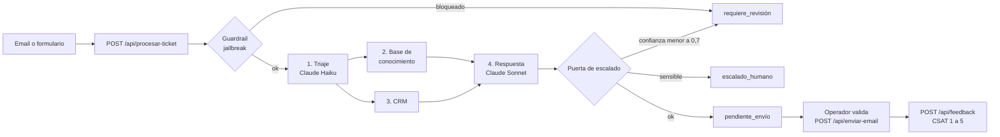

# Meraki, copiloto multiagente de atención al cliente

Copiloto de soporte para un SaaS B2B que recibe unos **3.000 tickets por mes**. Clasifica cada ticket, consulta el CRM y la base de conocimiento, arma un borrador de respuesta y deja a una persona aprobando lo sensible.

> Proyecto grupal de Aplicaciones de IA a los Negocios, Licenciatura en Negocios Digitales, Universidad ORT Uruguay, 2026. Cliente ficticio: MercadoSur Tech.

**[Ver el video de la demo completa](https://drive.google.com/file/d/1wMIsEQ7Me_zeRFJm96U0wbQIbRS0SMe6/view)** · **[Probar el MVP](https://v0-meraki-mvp-project.vercel.app)**

## Arquitectura



Ningún ticket sale al cliente sin que lo apruebe un operador. Las cancelaciones y los reembolsos nunca se responden en automático.

## Estructura del repo

```
meraki-copiloto-soporte/
├── backend/                      API del MVP 2.0, Node sin dependencias
│   ├── api/                      un archivo por endpoint, formato Vercel Functions
│   │   ├── procesar-ticket.js
│   │   ├── tickets.js
│   │   ├── ticket/[id].js
│   │   ├── enviar-email.js
│   │   └── feedback.js
│   ├── lib/
│   │   ├── procesar.js           orquestador del flujo completo
│   │   ├── triaje.js             clasificación en 8 categorías
│   │   ├── kb.js                 búsqueda de la sección de la KB
│   │   ├── crm.js                lookup del cliente
│   │   ├── respuesta.js          generación de la respuesta
│   │   ├── guardrails.js         detección de jailbreak
│   │   ├── prompts.js            prompts de Haiku y Sonnet
│   │   └── registro.js           log de tickets
│   ├── scripts/demo.js           corre los 16 tickets del piloto
│   ├── test/                     tests con node:test
│   ├── server.js                 servidor local
│   └── .env.example
├── knowledge-base/
│   └── base_de_conocimiento.md   las 9 secciones que consulta Meraki
├── data/
│   ├── crm_piloto.csv            10 clientes de prueba
│   └── tickets_piloto.csv        16 tickets del piloto con su resultado
└── docs/
    └── requerimientos_mvp2.md    frontend, backend, flujo y reglas
```

El frontend del MVP se construyó en v0 y está publicado en Vercel ([ver MVP](https://v0-meraki-mvp-project.vercel.app)).

## Cómo correrlo

Necesitás Node 20 o más. No hay que instalar nada.

```bash
cd backend
npm test          # 7 tests del flujo y los guardrails
npm run demo      # procesa los 16 tickets del piloto y muestra la tabla
npm start         # API en http://localhost:3001
```

Probar un ticket:

```bash
curl -X POST http://localhost:3001/api/procesar-ticket \
  -H "content-type: application/json" \
  -d '{"email":"juan.perez@acme.com","texto":"Olvidé mi contraseña y no puedo entrar"}'
```

### Dos modos

| Modo | Cuándo | Qué hace |
|---|---|---|
| **Simulación** | Sin `ANTHROPIC_API_KEY` | Triaje por reglas y respuesta con plantilla de la KB. Determinístico, sin llamadas externas, ideal para demos y tests |
| **Producción** | Con `ANTHROPIC_API_KEY` en `.env` | Triaje con Claude Haiku y respuesta con Claude Sonnet |

## Endpoints

| Método | Endpoint | Qué hace |
|---|---|---|
| POST | `/api/procesar-ticket` | Corre el flujo completo y devuelve el ticket con categoría, urgencia, confianza, KB usada, datos del cliente y borrador |
| GET | `/api/tickets` | Lista paginada con filtros `estado`, `categoria` y `desde` |
| GET | `/api/ticket/:id` | Detalle con cada paso del procesamiento |
| POST | `/api/enviar-email` | El operador aprueba y envía; rechaza los casos escalados |
| POST | `/api/feedback` | Registra el CSAT de 1 a 5 |

## Guardrails

- **Puerta de confianza:** por debajo de 0,7 el ticket vuelve como borrador para revisión.
- **Categorías sensibles:** cancelaciones y reembolsos van siempre a una persona.
- **Señales de escalado:** errores que persisten o cobros duplicados bajan la confianza para que los vea un operador.
- **Jailbreak:** los intentos de saltear las reglas se bloquean antes de llegar al modelo.
- **Respuestas acotadas a la KB:** el prompt prohíbe prometer reembolsos, créditos o plazos que no estén documentados.

El MVP publicado suma **control de acceso por rol:** Operador L1 y Supervisor L1.5 ven y pueden hacer cosas distintas.

## Diseño responsable

Pensado para cumplir la **Ley 18.331** de protección de datos personales de Uruguay, y **GDPR** y **LGPD** para clientes de la región. Los datos del repo son de prueba, de una empresa ficticia.

## Caso de negocio

| | Antes | Con Meraki |
|---|---|---|
| Operadores L1 | 5 | 2 |
| Costo mensual | USD 6.500 | USD 3.733 |
| Ahorro mensual | | USD 2.767 |
| Recupero de una inversión de USD 12.000 | | 4,3 meses |

## Decisiones de diseño

- **Dos modelos:** el chico (Haiku) clasifica rápido y barato; el grande (Sonnet) solo escribe la respuesta.
- **Humano en el circuito siempre:** Meraki propone, el operador decide. Reduce el riesgo de una respuesta equivocada en un SaaS B2B.
- **Modo simulación determinístico:** permite demostrar y testear el flujo sin costo de API y sin depender de la red.
- **Sin dependencias en el backend:** menos superficie de ataque y cero instalación para correrlo.
- **Registro de cada paso:** sirve para auditoría, debugging y para entrenar versiones futuras.

## Roadmap

- [x] Triaje en 8 categorías con urgencia y confianza
- [x] Consulta a KB y CRM, respuesta contextual
- [x] Puerta de escalado y guardrails
- [x] Endpoints de tickets, envío y CSAT
- [ ] Entrada por Gmail API con polling cada 5 minutos
- [ ] KB, CRM y log conectados a Google Docs y Sheets
- [ ] Dashboard con logs en tiempo real

## Stack

Claude API · MCP · RAG · Node.js · v0 · Next.js · Vercel

---

**Romina Cor Castro** · [Portafolio](https://rominacor21.github.io) · [LinkedIn](https://www.linkedin.com/in/rominacor/)
